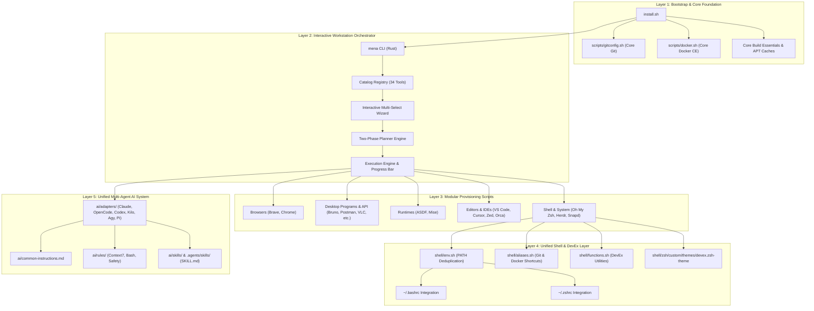

# Architecture & System Design Documentation

Welcome to the architectural documentation for the **Developer Dotfiles & Workstation Automation** platform. This directory provides comprehensive design specifications, component topologies, execution lifecycles, and security models governing the repository.

---

## Architecture Navigation

| Document | Focus & Scope |
| :--- | :--- |
| **[System Architecture Overview](file:///home/nmenag/personal-projects/dotfiles/docs/architecture.md)** | End-to-end architectural blueprint, design principles, system layers, and component topology |
| **[Workstation Orchestrator: `mena`](file:///home/nmenag/personal-projects/dotfiles/docs/mena-cli.md)** | Deep dive into the pure Rust CLI (`Clap` + `Dialoguer`), two-phase planning engine, and safety invariants |
| **[Unified Shell & Dotfiles](file:///home/nmenag/personal-projects/dotfiles/docs/shell-and-dotfiles.md)** | Centralized Bash & Oh My Zsh dotfiles architecture, PATH deduplication, and custom DevEx prompt theme |
| **[Unified Multi-Agent AI System](file:///home/nmenag/personal-projects/dotfiles/docs/ai-agent-system.md)** | 6-in-1 AI Coding Assistant integration (Claude, OpenCode, Codex, Kilo, Agy, Pi) with shared skills and rules |
| **[Security & Packaging Model](file:///home/nmenag/personal-projects/dotfiles/docs/security-and-packaging.md)** | Modern APT keyrings (`/etc/apt/keyrings/`), secret hygiene, and distribution agility (Ubuntu & Pop!_OS) |
| **[CI/CD & Quality Gates](file:///home/nmenag/personal-projects/dotfiles/docs/ci-cd-and-quality.md)** | GitHub Actions test matrix, Commitlint enforcement, PR title/size checks, and verification suites |

---

## High-Level System Architecture

The dotfiles repository is structured into five distinct, loosely-coupled layers:

---

## Core Architectural Invariants

1. **Declarative Planning vs. Imperative Execution**: Tool selection, dependency discovery, and permission requirements are evaluated into an explicit dependency plan before any system mutation occurs.
2. **Cancellation Invariant**: Aborting or declining execution during the review loop guarantees **zero actions and zero system mutations**.
3. **Core vs. Optional Decoupling**: Foundational dependencies (Git, Docker, C/C++ compilation toolchain) are treated as mandatory workstation foundations and installed automatically during bootstrap, completely decoupled from the interactive selection wizard.
4. **Idempotency & Non-Destructive Backups**: Every script can be executed repeatedly without generating duplicate lines or breaking existing states. Any user configuration file slated for modification is safely backed up with a timestamp in `~/.dotfiles_backup/`.
5. **Distribution Agnostic**: Dynamic codename detection prevents repository collisions between Ubuntu upstream (`jammy`, `noble`) and derivative distributions like Pop!_OS and Linux Mint.
