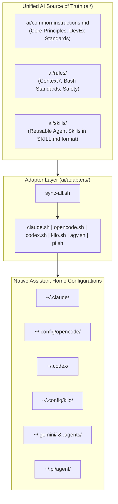
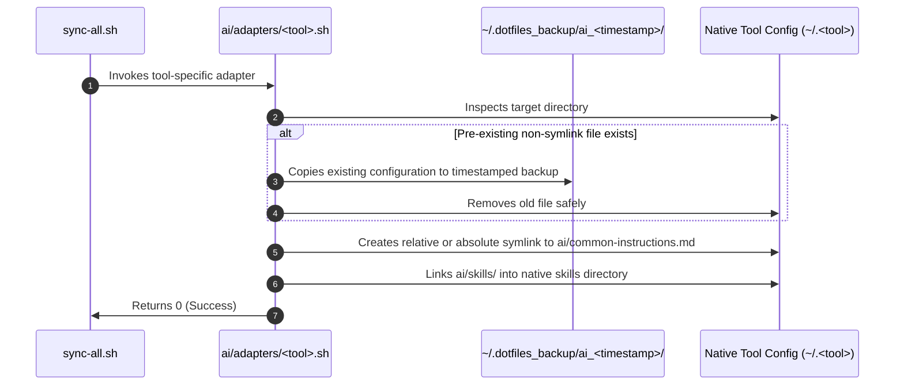

# Unified Multi-Agent AI System

This document describes the unified multi-agent coding assistant architecture implemented across **Claude Code**, **OpenCode**, **Codex CLI**, **Kilo CLI**, **Agy (Google Antigravity)**, and **Pi Coding Agent**.

---

## 1. Architectural Challenge

Modern development environments often utilize multiple AI terminal assistants depending on project context, model capabilities, or personal preference. Each AI CLI specifies its own configuration format, instructions path, and skills discovery directory:

| Assistant | CLI Command | Native Instructions File | Native Skills Directory |
| :--- | :--- | :--- | :--- |
| **Claude Code** | `claude` | `~/.claude/CLAUDE.md` | `~/.claude/skills/` |
| **OpenCode** | `opencode` | `~/.config/opencode/AGENTS.md` | `~/.config/opencode/skills/` |
| **Codex CLI** | `codex` | `~/.codex/AGENTS.md` | `~/.codex/skills/` |
| **Kilo CLI** | `kilo` | `~/.config/kilo/AGENTS.md` | `~/.config/kilo/skills/` |
| **Agy / Antigravity** | `agy` | `~/.gemini/GEMINI.md` | `~/.gemini/skills/` & `.agents/skills/` |
| **Pi Coding Agent** | `pi` | `~/.pi/agent/AGENTS.md` | `~/.pi/agent/skills/` |

Maintaining separate copies of developer instructions, coding standards, and custom skills leads to prompt drift, inconsistency, and stale guidelines.

---

## 2. Single Source of Truth Solution

This repository unifies all 6 assistants through a shared instruction core, modular rules, and an open skills standard:



### 2.1 Canonical Guidelines (`ai/common-instructions.md`)
Defines the universal contract for all agents operating in the workspace:
1. **Senior DevEx Mindset**: Preserve conventions, comments, and project architecture.
2. **Idempotency & Non-Destructive Actions**: Always create timestamped backups (`~/.dotfiles_backup/`) before touching personal dotfiles.
3. **Secret Hygiene**: Load credentials from `.env` or environment variables; never commit API keys or private tokens.
4. **Distribution Agnostic**: Support Ubuntu 22.04/24.04 and Pop!_OS Noble.
5. **User-Controlled Version Control**: **AI agents must never execute `git commit` or create automated git commits**. All changes remain in the working tree for user review.

### 2.2 Context7 Up-To-Date Documentation Rule
When researching libraries, frameworks, SDKs, or APIs, agents are instructed to fetch live official documentation via the Context7 MCP server rather than relying on frozen model weights:
1. `resolve-library-id`: Resolve library name to `/org/project` identifier.
2. `query-docs`: Query focused concept documentation.

### 2.3 Agent Skills Standard (`ai/skills/` & `.agents/skills/`)
Skills follow the open Agent Skills format:
- Folder containing `SKILL.md` with YAML frontmatter:
  ```yaml
  name: add-setup-script
  description: Use this skill when adding a new program, CLI tool, or service installer script to the dotfiles repository.
  ```
- Detailed markdown instructions, workflows, and optional `scripts/` or `resources/`.

---

## 3. Adapter Synchronization Engine

Synchronization is executed via [`ai/adapters/sync-all.sh`](file:///home/nmenag/personal-projects/dotfiles/ai/adapters/sync-all.sh) or [`scripts/ai-tools.sh`](file:///home/nmenag/personal-projects/dotfiles/scripts/ai-tools.sh).



### 3.1 Non-Destructive Invariant
Before any existing file is replaced with a symlink, the adapter creates a backup in `~/.dotfiles_backup/ai_<timestamp>/`. Running the sync repeatedly on an already-symlinked system performs non-destructive verification without creating unnecessary backups.

### 3.2 Native Antigravity Bridge & DRY Principle (`.agents/`)
For Google Antigravity (Agy), the repository maintains a root `.agents/` directory strictly conforming to the **DRY (Don't Repeat Yourself)** principle:
- All rules in `.agents/rules/` (`system-safety.md`, `bash-standards.md`, `context7.md`) are relative symbolic links pointing to `../../ai/rules/<rule>.md`.
- All skills in `.agents/skills/` (`add-setup-script`, `context7-docs`, `ubuntu-workstation-troubleshooting`, `validate-dotfiles`) are relative symbolic links pointing to `../../ai/skills/<skill>`.
- Root entrypoints ([`CLAUDE.md`](file:///home/nmenag/personal-projects/dotfiles/CLAUDE.md) and [`GEMINI.md`](file:///home/nmenag/personal-projects/dotfiles/GEMINI.md)) are relative symlinks pointing to [`AGENTS.md`](file:///home/nmenag/personal-projects/dotfiles/AGENTS.md).
- Duplicating physical files across `.agents/` and `ai/` is strictly prohibited. [`ai/adapters/agy.sh`](file:///home/nmenag/personal-projects/dotfiles/ai/adapters/agy.sh) maintains these links dynamically using relative symlinks without copying.
