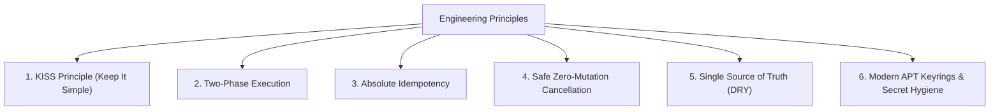
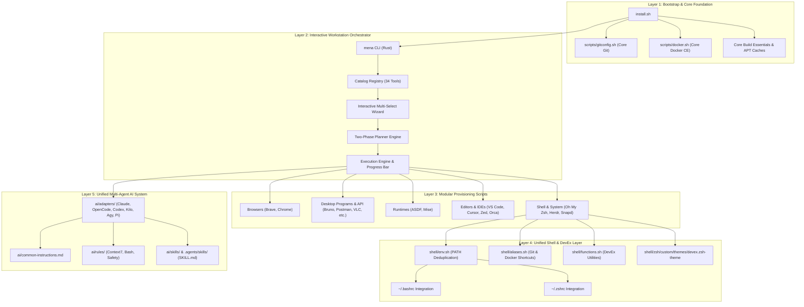
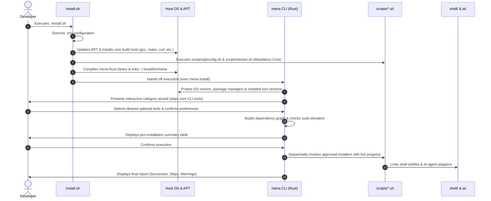
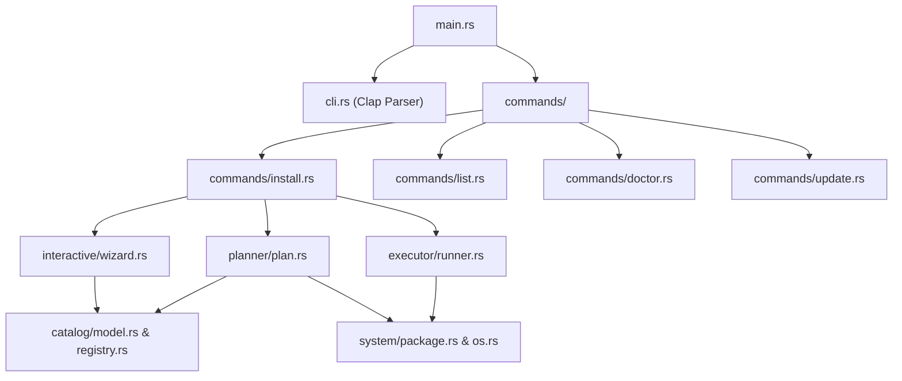
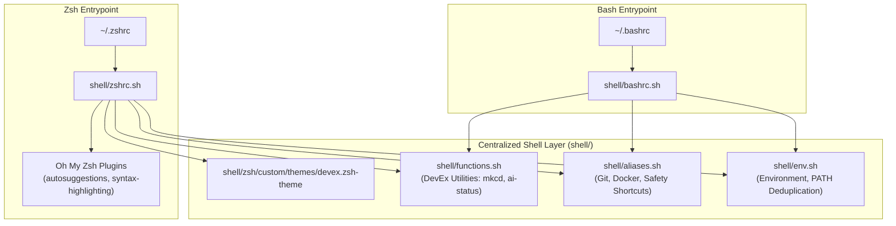
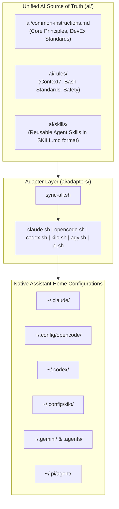

# System Architecture & Technical Design

This document provides the comprehensive system architecture, technical specifications, and subsystem design for the **Developer Dotfiles & Workstation Automation** platform on Debian/Ubuntu-based distributions (**Ubuntu 22.04 LTS**, **Ubuntu 24.04 LTS**, and **Pop!_OS 24.04 LTS Noble**).

---

## 1. Core Architectural Principles



1. **KISS Principle (Keep It Simple & Minimal)**:
   - Prefer simple, direct, and readable implementations over complex, over-engineered abstractions.
   - Avoid unnecessary layers, premature generalizations, redundant configuration, or sprawling multi-file fragmentation.
   - Rely on standard shell/CLI tools, built-in features, and unified single files before introducing third-party dependencies.

2. **Two-Phase Execution (Planning vs. Execution)**:
   - **Planning Phase**: Discovers host state, queries installed versions, resolves the dependency graph topologically, checks sudo requirements, and builds an explicit `InstallPlan`.
   - **Execution Phase**: Iterates only over explicitly approved plan items. Executes shell scripts, APT packages, Snap packages, or AI adapters sequentially while rendering progress via terminal bars.

3. **Absolute Idempotency**:
   - Every installer and shell script can be run an arbitrary number of times on a fresh or heavily customized machine without altering the intended state.
   - Guard blocks prevent duplicate exports or configuration lines in `~/.bashrc` or `~/.zshrc`.
   - APT repositories check for keyrings in `/etc/apt/keyrings/` before downloading keys.

4. **Safe Cancellation Invariant**:
   - If a user aborts during any interactive wizard step, summary review, or confirmation prompt, the planner yields zero actions and terminates immediately. No temporary files are left, no packages are downloaded, and no system files are mutated.

5. **Non-Destructive Backups**:
   - Any operation touching pre-existing user configurations (such as dotfiles or AI adapter directories) creates a timestamped archive under `~/.dotfiles_backup/` before applying updates.

6. **Strict Secret & Credential Isolation**:
   - API keys, SSH keys, personal tokens, and OAuth credentials must never exist in repository code or Git tracking. Dynamic values are populated through `.env` (guarded by `.gitignore`) or gathered interactively.

7. **Distribution Agility**:
   - Dynamic codename detection prevents repository collisions between Ubuntu upstream (`jammy`, `noble`) and derivative distributions like Pop!_OS and Linux Mint:
     ```bash
     CODENAME="${UBUNTU_CODENAME:-$(lsb_release -cs)}"
     ```

---

## 2. Layered Architecture & Component Topology

The system is structured into five distinct, loosely-coupled layers:



---

## 3. End-to-End Execution Lifecycle

When bootstrapping a developer machine from scratch, execution progresses through the following deterministic stages:



---

## 4. Subsystem 1: Workstation Orchestrator (`mena` CLI)

`mena` is written in **pure Rust** using `Clap`, `Dialoguer`, `indicatif`, and `console`.



### 4.1 Domain Model & Registry
- **Categories**: `Browsers`, `CliTools` (mandatory core, auto-filtered out from wizard), `Programs` (desktop apps & API clients), `Runtimes` (ASDF, Mise), `DevUtilities` (editors, IDEs), `AiAssistants` (6-in-1 assistants), `SkillManagement`, `ShellEnvironment`.
- **Install Methods**: `Script(&'static str)`, `AiAdapter(&'static str)`, `AptPackage(&'static str)`, `SnapPackage { name, classic }`, `ShellCommand(&'static str)`.
- **GUI Version Probing**: For Electron/GUI apps (Cursor, Postman, Bruno, pgAdmin, Android Studio), `version_flag` is set to `None` to prevent background CLI hangs during probing.

### 4.2 Interactive Wizard & Two-Phase Review Loop
1. Presents multi-select menus grouped by category.
2. Annotates installed tools with current host versions: `[Installed: Google Chrome 151.0.7922.137]`.
3. Prompts for Git user identity if missing.
4. Renders the pre-installation summary table with three paths:
   - **Proceed**: Hands plan to execution engine.
   - **Modify**: Loops back to tool selection.
   - **Cancel**: Terminates immediately with **0 actions and 0 mutations**.

### 4.3 Verified Invariants
- **Cancellation Safety** (`tests/test_cancellation.rs`): Aborted plans execute zero actions.
- **Dry-Run Safety** (`test_dry_run_executes_no_mutations`): Simulates the full plan without running any child processes.
- **Selective Execution** (`test_only_approved_actions_are_executed`): Unselected tools are never queued or executed.

---

## 5. Subsystem 2: Unified Shell & Dotfiles (`shell/`)

The shell layer establishes a single source of truth for both Bash and Zsh:



### 5.1 PATH Deduplication & Precedence (`shell/env.sh`)
Prepends user directories only if they exist and are not already in `$PATH`:
1. `~/.local/bin` (mena, dotctl, pipx, local CLI tools)
2. `~/.cargo/bin` (Cargo, Rust toolchains)
3. `~/.asdf/bin` and `~/.asdf/shims` (ASDF version manager)
4. `~/.local/share/mise/shims` (Mise version manager)
5. System paths (`/usr/local/bin`, `/usr/bin`, `/bin`)

### 5.2 Safety Aliases & DevEx Utilities
- **Safety Defaults**: `alias rm='rm -i'`, `alias cp='cp -i'`, `alias mv='mv -i'`.
- **Git Shortcuts**: `gst`, `gco`, `gcb`, `gd`, `gp`, `gl`, `glog`.
- **DevEx Functions**: `ai-status` (audits all 6 AI CLIs), `mkcd <dir>`, `extract <archive>`, `path_inspect`, `reload_shell`.
- **Custom Prompt Theme** (`devex.zsh-theme`): Zero-lag Git branch, dirty status indicator, and exit code styling.

### 5.3 Guarded Appends
To preserve user configurations, scripts never append blindly:
```bash
if [[ -f "$HOME/.zshrc" ]] && ! grep -q "DOTFILES_INTEGRATION" "$HOME/.zshrc"; then
  cat <<'EOT' >> "$HOME/.zshrc"
# --- DOTFILES_INTEGRATION ---
if [ -f "$HOME/personal-projects/dotfiles/shell/zshrc.sh" ]; then
  source "$HOME/personal-projects/dotfiles/shell/zshrc.sh"
fi
# --- END DOTFILES_INTEGRATION ---
EOT
fi
```

---

## 6. Subsystem 3: Security & Packaging Model

### 6.1 Modern Compartmentalized APT Keyrings
Deprecated `apt-key` trusted keys globally for all repositories. This repository strictly uses scoped `/etc/apt/keyrings/`:


### 6.2 Packaging Strategy Matrix
| Tool | Installation Channel | Method & Sandbox Properties |
| :--- | :--- | :--- |
| **Brave, Bruno, Cursor, Docker, Mise, pgAdmin** | **Signed APT** | Official vendor signed keyrings in `/etc/apt/keyrings/` |
| **Google Chrome, Orca, MongoDB Compass** | **Official Deb** | Downloaded via HTTPS to `mktemp -d`, installed with `dpkg -i` + `apt-get install -f -y` |
| **Postman, Ghostty, Android Studio** | **Snap** | Canonical Snap confinement (`--classic` for dev tools requiring full system access) |
| **ASDF, Zed** | **Vendor Tarball / Script** | User-space installation (`~/.asdf`, `~/.local/bin`), zero root mutations |
| **Git, Build Essentials, VLC, Flameshot, BleachBit** | **Native Ubuntu APT** | Standard distribution repository packages (`sudo apt-get install -y`) |

### 6.3 Automated Secret Hygiene
- **Hardened `.gitignore`**: Excludes `.env`, `.env.*`, `*.pem`, `*.key`, `*.token`, `credentials.json`, and `~/.dotfiles_backup/`.
- **Git Index Scanner** ([`scripts/verify.sh`](file:///home/nmenag/personal-projects/dotfiles/scripts/verify.sh)): Audits all tracked files in Git to prevent staging or committing secrets:
  ```bash
  TRACKED_SECRETS="$(git ls-files | grep -E '(\.key|\.pem|\.token|\.secret|credentials\.json|auth\.json)$' || true)"
  if [[ -n "$TRACKED_SECRETS" ]]; then
    echo "SECURITY RISK: Detected tracked secrets in Git index"
    exit 1
  fi
  ```

---

## 7. Subsystem 4: Unified Multi-Agent AI System (`ai/`)

Modern workflows utilize multiple AI terminal assistants. This repository connects **6 AI coding assistants** through a shared instruction core, modular rules, and an open skills standard:

| Assistant | CLI Command | Native Instructions Path | Native Skills Path |
| :--- | :--- | :--- | :--- |
| **Claude Code** | `claude` | `~/.claude/CLAUDE.md` | `~/.claude/skills/` |
| **OpenCode** | `opencode` | `~/.config/opencode/AGENTS.md` | `~/.config/opencode/skills/` |
| **Codex CLI** | `codex` | `~/.codex/AGENTS.md` | `~/.codex/skills/` |
| **Kilo CLI** | `kilo` | `~/.config/kilo/AGENTS.md` | `~/.config/kilo/skills/` |
| **Agy / Antigravity** | `agy` | `~/.gemini/GEMINI.md` | `~/.gemini/skills/` & `.agents/skills/` |
| **Pi Coding Agent** | `pi` | `~/.pi/agent/AGENTS.md` | `~/.pi/agent/skills/` |



### 7.1 Context7 Live Documentation Rule
Agents are instructed to fetch live official documentation via Context7 MCP rather than relying on frozen model weights:
1. `resolve-library-id`: Resolve library name to `/org/project` identifier.
2. `query-docs`: Query focused concept documentation.

### 7.2 Native Antigravity Bridge & DRY Symbolic Links (`.agents/`)
To uphold the DRY principle, `.agents/` contains zero duplicated physical files:
- `.agents/rules/` symlinks to `../../ai/rules/<rule>.md`.
- `.agents/skills/` symlinks to `../../ai/skills/<skill>`.
- Root entrypoints ([`CLAUDE.md`](file:///home/nmenag/personal-projects/dotfiles/CLAUDE.md), [`GEMINI.md`](file:///home/nmenag/personal-projects/dotfiles/GEMINI.md)) symlink to [`AGENTS.md`](file:///home/nmenag/personal-projects/dotfiles/AGENTS.md).
- [`ai/adapters/agy.sh`](file:///home/nmenag/personal-projects/dotfiles/ai/adapters/agy.sh) provisions and maintains these links dynamically using relative symlinks without copying.

---

## 8. Directory Layout

```text
.
├── AGENTS.md                  # Root workspace rules for AI agents
├── CLAUDE.md                  # Claude Code workspace entrypoint (links to AGENTS.md)
├── GEMINI.md                  # Antigravity / Gemini entrypoint (links to AGENTS.md)
├── docs/                      # Architecture & system design documentation
│   ├── README.md              # Documentation index & quick reference
│   ├── architecture.md        # Comprehensive system architecture & subsystem specs (this file)
│   └── ci-cd-and-quality.md   # Quality gates & GitHub Actions CI
├── install.sh                 # Master workstation setup entrypoint
├── mena/                      # Rust CLI source code (Clap + Dialoguer)
│   ├── Cargo.toml             # Rust package configuration
│   ├── src/                   # CLI, catalog, planner, wizard, executor
│   └── tests/                 # Integration tests (cancellation, planner, catalog)
├── LICENSE                    # MIT license
├── README.md                  # Human-readable documentation
├── .env.sample                # Sample environment configuration
├── .gitignore                 # Excludes .env, secrets, IDE configs, etc.
├── ai/                        # Unified AI agent architecture
│   ├── common-instructions.md # Universal guidelines for all 6 AI CLIs
│   ├── rules/                 # Shared rules (Context7, Bash standards, Safety)
│   ├── skills/                # Reusable Agent Skills (SKILL.md format)
│   └── adapters/              # CLI adapters (claude, opencode, codex, kilo, agy, pi)
├── shell/                     # Centralized shell dotfiles
│   ├── env.sh                 # Environment variables and PATH deduplication
│   ├── aliases.sh             # Shared Git, Docker, and navigation shortcuts
│   ├── functions.sh           # DevEx productivity functions (ai-status, mkcd, etc.)
│   ├── bashrc.sh              # Bash integration entrypoint
│   ├── zshrc.sh               # Zsh integration entrypoint
│   └── zsh/custom/themes/     # Custom prompt themes (devex.zsh-theme)
├── .agents/                   # Workspace AI agent customizations (Antigravity bridge)
│   ├── rules/                 # Modular agent rules (symlinked to ai/rules/)
│   └── skills/                # On-demand agent runbooks (symlinked to ai/skills/)
└── scripts/                   # Modular installation scripts
```
