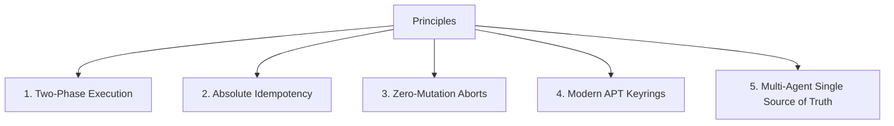
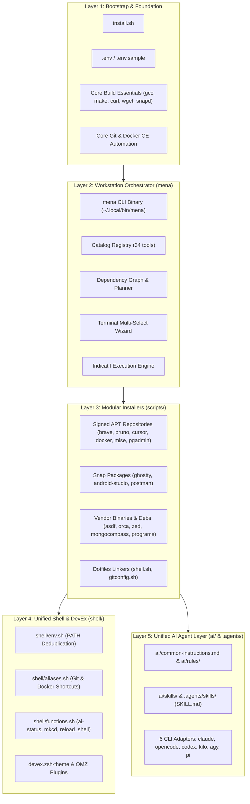
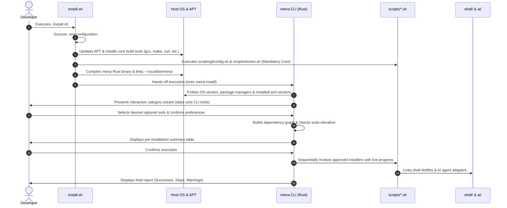

# System Architecture Overview

This document describes the high-level system architecture and engineering principles governing the **Developer Dotfiles & Workstation Automation** repository.

---

## 1. Architectural Principles

The repository is designed to automate the provisioning, configuration, and daily operation of developer workstations running Debian/Ubuntu distributions (specifically **Ubuntu 22.04 LTS**, **Ubuntu 24.04 LTS**, and **Pop!_OS 24.04 LTS (Noble)**).



### 1.1 Two-Phase Execution (Planning vs. Execution)
System mutation is separated strictly into:
1. **Planning Phase**: Collects user desires, discovers existing host installations, queries versions, resolves the dependency graph topologically, checks for `sudo` requirements, and produces a complete `InstallPlan`.
2. **Execution Phase**: Iterates only over explicitly approved plan items. Executes shell scripts, APT packages, Snap packages, or AI adapters sequentially while rendering progress via terminal bars.

### 1.2 Absolute Idempotency
- Every installer and shell script can be run an arbitrary number of times on a fresh or heavily customized machine without altering the intended state.
- Guard blocks prevent duplicate exports or configuration lines in `~/.bashrc` or `~/.zshrc`.
- APT repositories check for keyrings in `/etc/apt/keyrings/` before downloading keys.

### 1.3 Safe Cancellation Invariant
If a user aborts during any interactive wizard step, summary review, or confirmation prompt, the planner yields zero actions and terminates immediately. No temporary files are left, no packages are downloaded, and no system files are mutated.

### 1.4 Non-Destructive Backups
Any operation touching pre-existing user configurations (such as dotfiles or AI adapter directories) creates a timestamped archive under `~/.dotfiles_backup/` before applying updates.

### 1.5 Strict Secret & Credential Isolation
API keys, SSH keys, personal tokens, and OAuth credentials must never exist in repository code or Git tracking. Dynamic values are populated through `.env` (guarded by `.gitignore`) or gathered interactively.

---

## 2. Layered Architecture

The workstation automation system is composed of five modular layers:



---

## 3. End-to-End Execution Lifecycle

When bootstrapping a developer machine from scratch, execution progresses through the following deterministic stages:



---

## 4. Subsystem Interactions

### 4.1 Bootstrap Hand-off to `mena`
[`install.sh`](file:///home/nmenag/personal-projects/dotfiles/install.sh) acts as the minimalist entrypoint. It ensures that the machine has a functioning compiler (`build-essential`), cURL, Git, Docker, and Cargo/Rust. Once `mena` is compiled to `mena/target/release/mena`, `install.sh` uses POSIX `exec` to hand off terminal control directly to `mena install`.

### 4.2 Script Independence
Every modular script inside [`scripts/`](file:///home/nmenag/personal-projects/dotfiles/scripts) can be executed independently outside of `mena` or `install.sh`:
```bash
./scripts/mise.sh
./scripts/postman.sh
./scripts/bruno.sh
```
All scripts derive their own absolute paths (`SCRIPT_DIR="$(cd "$(dirname "${BASH_SOURCE[0]}")" && pwd)"`) and root paths (`ROOT_DIR="$(cd "$SCRIPT_DIR/.." && pwd)"`), making invocation directory-agnostic.

### 4.3 AI Assistant Adapters
Rather than maintaining divergent configuration files for multiple AI assistants, the repository maintains a single canonical guideline set in [`ai/common-instructions.md`](file:///home/nmenag/personal-projects/dotfiles/ai/common-instructions.md). Specialized adapters in [`ai/adapters/`](file:///home/nmenag/personal-projects/dotfiles/ai/adapters) symlink these instructions and shared skills into each tool's native home configuration directory (`~/.claude`, `~/.config/opencode`, `~/.codex`, `~/.config/kilo`, `~/.gemini`, `~/.pi`).

---

## 5. Directory Structure Mapping

```text
.
├── docs/                      # Architectural and system documentation
│   ├── README.md              # Documentation index and navigation
│   ├── architecture.md       # High-level architecture and system design (this file)
│   ├── mena-cli.md            # Workstation orchestrator deep dive
│   ├── shell-and-dotfiles.md  # Bash and Oh My Zsh dotfiles architecture
│   ├── ai-agent-system.md     # 6-in-1 AI Coding Assistant architecture
│   ├── security-and-packaging.md # APT keyrings, permissions, and security
│   └── ci-cd-and-quality.md   # CI/CD workflows and automated verification
├── install.sh                 # Master bootstrap entrypoint
├── mena/                      # Pure Rust workstation orchestrator
│   ├── Cargo.toml             # Rust package configuration
│   ├── src/                   # CLI, catalog, planner, wizard, executor
│   └── tests/                 # Integration tests (cancellation, planner, catalog)
├── scripts/                   # Idempotent modular installer scripts
├── shell/                     # Centralized Bash & Oh My Zsh dotfiles
├── ai/                        # Unified AI agent instructions, rules, and adapters
└── .agents/                   # Workspace AI agent customizations and skills
```
