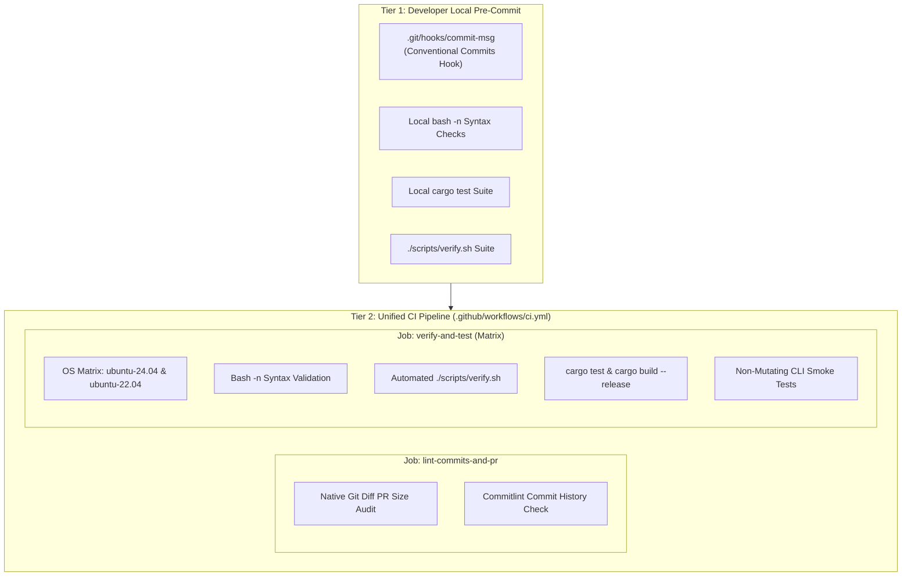
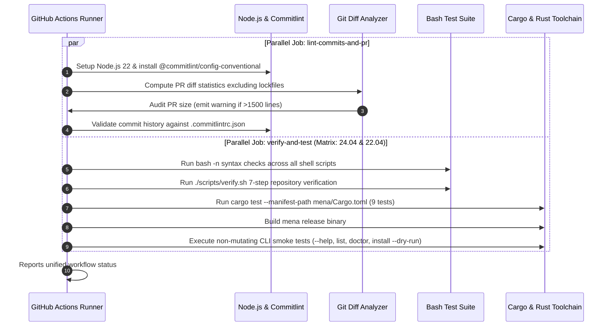

# CI/CD & Quality Gates

This document details the automated quality gates, linting systems, Commitlint standards, and Continuous Integration (GitHub Actions) pipelines protecting the repository.

---

## 1. Quality Gate Architecture

Quality assurance is enforced through three complementary tiers:



---

## 2. Local Verification Suite (`scripts/verify.sh`)

[`scripts/verify.sh`](file:///home/nmenag/personal-projects/dotfiles/scripts/verify.sh) is an automated 7-step test suite designed to be executed locally before pushing code or creating pull requests:

| Stage | Inspection Target | Acceptance Criteria |
| :--- | :--- | :--- |
| **1. Bash Syntax** | All `*.sh` scripts in `scripts/`, `shell/`, `ai/adapters/`, `install.sh` | Clean exit from `bash -n` on all files |
| **2. Permissions** | All script files | Must possess POSIX executable bit (`+x`); automatically fixes if missing |
| **3. Security Hygiene** | `.env`, `.env.sample`, `.gitignore`, tracked files | `.env` ignored; zero keys, certificates, or tokens tracked in Git index |
| **4. Shell Dotfiles** | `shell/` components | All environment, alias, function, and theme files exist |
| **5. AI Agent Layer** | `AGENTS.md`, `CLAUDE.md`, `GEMINI.md`, `SKILL.md` | Entrypoints exist; all skills have valid `name:` and `description:` frontmatter |
| **6. AI Adapters** | `ai/adapters/` | All 6 CLI adapter scripts exist and are executable |
| **7. `mena` Rust CLI** | `mena/` crate | `Cargo.toml` exists; `cargo check` compiles without errors |

---

## 3. Commit Message Standards (Commitlint)

The repository follows the [Conventional Commits](https://www.conventionalcommits.org/) standard configured in [`.commitlintrc.json`](file:///home/nmenag/personal-projects/dotfiles/.commitlintrc.json).

### 3.1 Format Specification
```text
<type>(<optional-scope>): <description>

[optional body]

[optional footer(s)]
```

### 3.2 Permitted Commit Types
- `feat`: New developer tool, installer script, or major feature.
- `fix`: Bug fix in installers, shell dotfiles, or CLI code.
- `chore`: Maintenance, renaming, dependencies, or configuration changes.
- `docs`: Documentation updates (README, docs/).
- `style`: Formatting, whitespace, or code styling adjustments.
- `refactor`: Code reorganization without functional behavior changes.
- `perf`: Performance improvements (e.g. prompt lag optimizations).
- `test`: Adding or updating integration tests in `mena/tests/`.
- `build`: Cargo build configs, packaging, or external build changes.
- `ci`: GitHub Actions workflow or Commitlint configurations.
- `revert`: Reverting a previous commit.

---

## 4. Continuous Integration Pipeline (`.github/workflows/ci.yml`)

The repository uses a single, unified CI pipeline ([`.github/workflows/ci.yml`](file:///home/nmenag/personal-projects/dotfiles/.github/workflows/ci.yml)) executing on pushes to `main`, `master`, and standard branches (`chore/**`, `feature/**`, `fix/**`), as well as pull requests and manual dispatches:



---

## 5. Pull Request Quality Checks (Native In-Runner Execution)

All pull request quality validations are executed natively within the runner using Node and Bash utilities, requiring only standard read permissions (`contents: read`, `pull-requests: read`) and eliminating external commit status API permission errors:

1. **Native PR Size Audit**:
   - Calculates changed lines using `git diff --numstat "origin/$GITHUB_BASE_REF"...HEAD` while ignoring generated files (`Cargo.lock`, `package-lock.json`).
   - Categorizes pull request magnitude:
     - `size/XS`: 0–19 lines
     - `size/S`: 20–99 lines
     - `size/M`: 100–299 lines
     - `size/L`: 300–799 lines
     - `size/XL`: 800–1499 lines
     - `size/XXL`: 1500+ lines (automatically emits GitHub annotation warning for large PRs)
