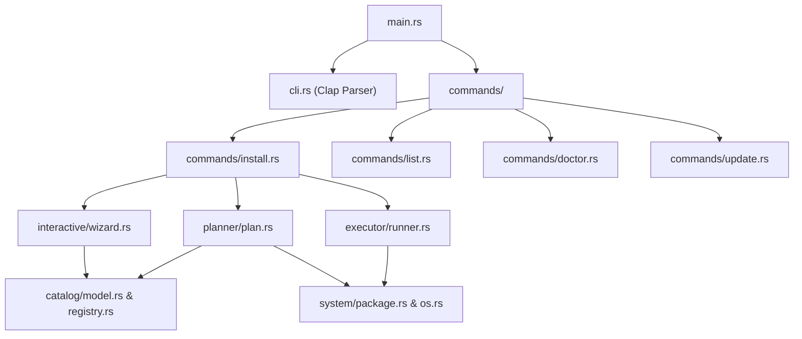
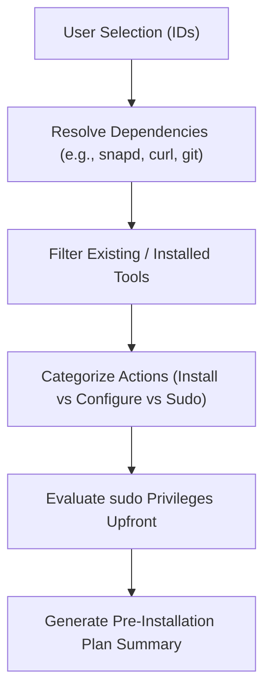
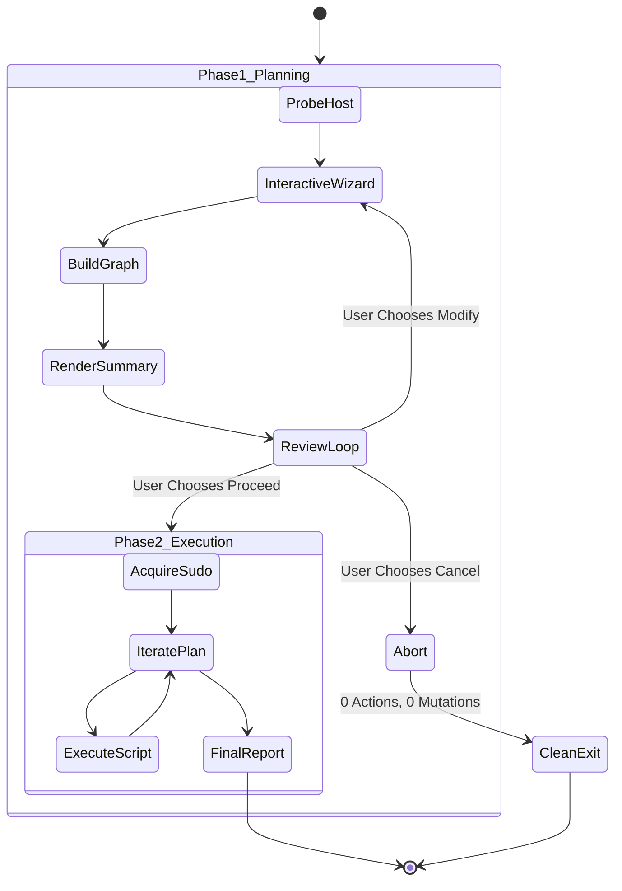

# Workstation Orchestrator: `mena` CLI

`mena` is the command-line orchestrator for workstation installation, diagnostics, and synchronization. It is written in **pure Rust** utilizing `Clap`, `Dialoguer`, `indicatif`, and `console`.

---

## 1. Design Motivation

Traditional workstation dotfiles often rely on monolithic bash scripts or Node.js/TypeScript runtimes. `mena` adopts Rust to deliver:
- **Zero Runtime Dependencies**: Does not require Node.js, npm, Python, or Ruby to be installed on the target machine prior to orchestration.
- **Strict Memory & Concurrency Safety**: Compile-time verification of data structures, states, and optionals.
- **Rich Terminal UX**: Multi-select menus, real-time installed version detection, styled summary tables, and animated progress bars.
- **Formal Invariant Guarantees**: Clean separation of planning from execution, guaranteeing zero mutations when cancelled.

---

## 2. Module Topology

The `mena` crate is structured into six modular sub-packages:



### 2.1 Domain Model (`catalog/model.rs`)
Defines the core catalog structures:
- `Category`: Enumeration of workstation functional domains:
  - `Browsers` (`browser`)
  - `CliTools` (`cli` - Core System Tools)
  - `Programs` (`programs` / `apps` - Desktop Programs & API Clients)
  - `Runtimes` (`runtimes` - ASDF, Mise)
  - `DevUtilities` (`dev` - Editors, Terminals, IDEs)
  - `AiAssistants` (`ai` - 6-in-1 AI Coding Assistants)
  - `SkillManagement` (`skills` - Agent Skills CLI)
  - `ShellEnvironment` (`shell` - Dotfiles & Themes)
- `Category::wizard_categories()`: Returns all optional categories, explicitly filtering out `Category::CliTools` so interactive users are never prompted for mandatory core foundations.
- `InstallMethod`: Tagged union supporting:
  - `Script(&'static str)`: Workstation bash script in `scripts/`.
  - `AiAdapter(&'static str)`: AI adapter synchronizer in `ai/adapters/`.
  - `AptPackage(&'static str)`: Native APT package.
  - `SnapPackage { name, classic }`: Snap package.
  - `ShellCommand(&'static str)`: Validated shell command.
- `DetectionMethod`: Probing strategy (`Command(cmd)`, `Dpkg(pkg)`, `Path(rel)`).
- `ToolStatus`: `Installed { version, path }` vs `NotInstalled`.

### 2.2 Catalog Registry (`catalog/registry.rs`)
Maintains the static registry of **34 developer tools**. Real-time probing runs dynamically when `all_tools()` or `tools_by_category()` is evaluated.

For GUI and Electron applications (such as Cursor, Postman, Bruno, pgAdmin, Android Studio), `version_flag` is set to `None` to prevent background CLI processes from hanging while attempting to initialize an X11/Wayland GUI window.

### 2.3 Dependency Planner (`planner/plan.rs`)
The planner evaluates the dependency graph before any action is executed:



### 2.4 Interactive Wizard (`interactive/wizard.rs`)
Presents a category-by-category questionnaire using `dialoguer::MultiSelect`:
1. Skips `Category::CliTools` automatically.
2. Marks tools already installed on the machine with their detected version: `[Installed: Google Chrome 151.0.7922.137]`.
3. Collects Git user identity (`name`, `email`) if not already present in Git configuration or `.env`.
4. Renders the plan summary and prompts the user with three options:
   - **Proceed**: Passes plan to the execution engine.
   - **Modify**: Loops back to re-enter tool selection.
   - **Cancel**: Aborts immediately with zero mutations.

### 2.5 Execution Engine (`executor/runner.rs`)
Iterates through approved `PlanItem`s:
- Displays an animated spinner and progress bar (`indicatif::ProgressBar`).
- Captures `stdout` and `stderr` streams safely.
- Renders a final execution report detailing successes, skips, and any non-fatal warnings.

---

## 3. Two-Phase Architecture & Invariants



### 3.1 Cancellation Safety Invariant
Integration tests enforce that if a user aborts during the review loop or declines execution, the system state remains untouched:
```rust
// Verified by mena/tests/test_cancellation.rs
#[test]
fn test_cancellation_produces_zero_actions() {
    let plan = InstallPlan::build(&["brave", "vscode"], true);
    let approved = false; // User cancels
    let executed = execute_plan(&plan, approved);
    assert_eq!(executed.len(), 0);
}
```

### 3.2 Dry-Run Verification Invariant
Running `mena install --dry-run` traverses the complete planning engine, resolves dependencies, and formats the execution plan without executing any child processes or invoking package managers.
