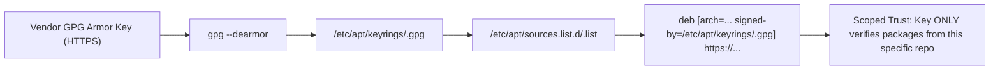
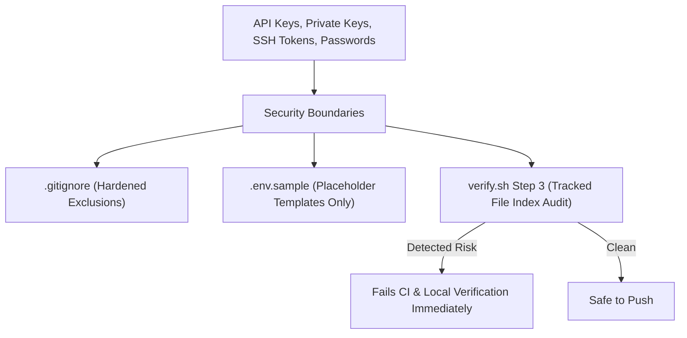

# Security & Packaging Model

This document outlines the security architecture, package management standards, and distribution compatibility strategies employed across the dotfiles automation codebase.

---

## 1. Modern APT Keyring & Repository Security

Debian and Ubuntu deprecated `apt-key` due to significant security vulnerabilities: `apt-key add` trusts a downloaded key globally for **all** APT repositories, allowing a compromised third-party key to sign and replace core OS packages.

This repository strictly enforces modern, compartmentalized APT keyrings:



### 1.1 Secure Keyring Installation Pattern
Every APT repository installer follows this pattern:
```bash
# 1. Ensure modern keyrings directory exists with secure permissions
sudo install -m 0755 -d /etc/apt/keyrings

# 2. Download and dearmor GPG key directly to /etc/apt/keyrings/
curl -fsSL "https://example.com/gpg.key" | gpg --dearmor | sudo tee /etc/apt/keyrings/mytool.gpg > /dev/null
sudo chmod a+r /etc/apt/keyrings/mytool.gpg

# 3. Reference key explicitly via [signed-by=...]
echo "deb [arch=$(dpkg --print-architecture) signed-by=/etc/apt/keyrings/mytool.gpg] https://example.com/deb stable main" | \
  sudo tee /etc/apt/sources.list.d/mytool.list > /dev/null

# 4. Update repository cache cleanly
sudo apt-get update -y -o Dir::Etc::sourcelist="sources.list.d/mytool.list" -o Dir::Etc::sourceparts="-" -o APT::Get::List-Cleanup="0"
```

---

## 2. Distribution Agility (Ubuntu & Derivatives)

Developers frequently use Ubuntu-derived distributions such as **Pop!_OS** or **Linux Mint**. A common failure mode occurs when scripts query `lsb_release -cs`, which on Pop!_OS returns `noble` (for Pop!_OS 24.04), but on older or customized forks may return derivative release names that upstream package mirrors do not host.

### Dynamic Codename Resolution
All installer scripts query the underlying Ubuntu upstream base:
```bash
# Resolve Ubuntu base codename dynamically
CODENAME="${UBUNTU_CODENAME:-$(lsb_release -cs)}"
```
If `/etc/os-release` defines `UBUNTU_CODENAME`, it takes precedence. Otherwise, it safely falls back to standard `lsb_release -cs`.

---

## 3. Secret Hygiene & Repository Security

The repository implements strict controls to prevent sensitive data exposure:



### 3.1 Hardened `.gitignore`
The repository excludes all local environments and credential structures:
```gitignore
.env
.env.*
!.env.sample
*.pem
*.key
*.token
*.secret
credentials.json
auth.json
~/.dotfiles_backup/
```

### 3.2 Automated Git Index Secret Scanner
[`scripts/verify.sh`](file:///home/nmenag/personal-projects/dotfiles/scripts/verify.sh) scans all files indexed by Git to ensure credentials are never staged or committed:
```bash
TRACKED_SECRETS="$(git ls-files | grep -E '(\.key|\.pem|\.token|\.secret|credentials\.json|auth\.json)$' || true)"
if [[ -n "$TRACKED_SECRETS" ]]; then
  echo "SECURITY RISK: Detected tracked secrets in Git index"
  exit 1
fi
```

---

## 4. Packaging Strategy Matrix

Tools are packaged according to vendor recommendations and sandbox isolation needs:

| Tool | Installation Channel | Method & Sandbox Properties |
| :--- | :--- | :--- |
| **Brave, Bruno, Cursor, Docker, Mise, pgAdmin** | **Signed APT** | Official vendor signed keyrings in `/etc/apt/keyrings/` |
| **Google Chrome, Orca, MongoDB Compass** | **Official Deb** | Downloaded via HTTPS to `mktemp -d`, installed with `dpkg -i` + `apt-get install -f -y` |
| **Postman, Ghostty, Android Studio** | **Snap** | Canonical Snap confinement (`--classic` for dev tools requiring full system access) |
| **ASDF, Zed** | **Vendor Tarball / Script** | User-space installation (`~/.asdf`, `~/.local/bin`), zero root mutations |
| **Git, Build Essentials, VLC, Flameshot, BleachBit** | **Native Ubuntu APT** | Standard distribution repository packages (`sudo apt-get install -y`) |
