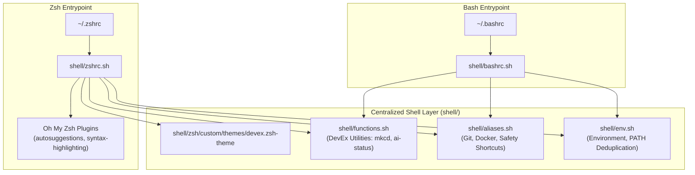

# Unified Shell & Dotfiles Architecture

This document outlines the architecture, loading sequence, and DevEx enhancements provided by the centralized shell dotfiles layer in `shell/`.

---

## 1. Design Overview

Developer workstations typically split configurations between Bash (often used in non-interactive subshells, system scripts, and basic terminals) and Zsh (often used with Oh My Zsh for daily interactive development).

To prevent duplication and drift, this repository adopts a **single source of truth** architecture for all shell configurations:



---

## 2. Component Breakdown

### 2.1 Environment & PATH Deduplication (`shell/env.sh`)
- Establishes essential environment variables (`EDITOR`, `LANG`, `LC_ALL`).
- Deduplicates and normalizes entries in `$PATH`:
  ```bash
  # Prepends directory to PATH only if directory exists and is not already in PATH
  _path_prepend() {
    if [[ -d "$1" ]] && [[ ":$PATH:" != *":$1:"* ]]; then
      PATH="$1:$PATH"
    fi
  }
  ```
- Ensures proper precedence for user bins:
  1. `~/.local/bin` (mena, dotctl, pipx, local CLI tools)
  2. `~/.cargo/bin` (Cargo, Rust toolchains)
  3. `~/.asdf/bin` and `~/.asdf/shims` (ASDF version manager)
  4. `~/.local/share/mise/shims` (Mise version manager)
  5. System paths (`/usr/local/bin`, `/usr/bin`, `/bin`)

### 2.2 Aliases (`shell/aliases.sh`)
Centralizes all shell abbreviations with safety defaults:
- **Git Aliases**: `g`, `gst`, `gaa`, `gc`, `gco`, `gcb`, `gd`, `gl`, `gp`, `glog`.
- **Docker Aliases**: `d`, `dco`, `dps`, `dpsa`, `di`, `dex`.
- **Directory Traversal**: `..`, `...`, `....`, `.....`, `dotfiles`.
- **Safety Flags**: Prevents accidental recursive file loss:
  ```bash
  alias rm='rm -i'
  alias cp='cp -i'
  alias mv='mv -i'
  ```

### 2.3 DevEx Functions (`shell/functions.sh`)
Provides productivity functions available across both Bash and Zsh:
- `ai-status`: Audits installation, binary locations, and active versions for all 6 AI assistants.
- `mkcd <dir>`: Creates directory hierarchy and immediately changes working directory into it.
- `extract <file>`: Universal archive extractor supporting `.tar.gz`, `.tar.bz2`, `.zip`, `.rar`, `.7z`, `.gz`, and `.tar`.
- `path_inspect`: Prints each entry in `$PATH` on a separate numbered line for inspection.
- `reload_shell`: Detects whether Bash or Zsh is running and re-sources active configurations idempotently.

### 2.4 Custom Prompt Theme (`devex.zsh-theme`)
The custom Zsh theme provides an ultra-fast, zero-lag prompt with:
- Current working directory abbreviation.
- Real-time Git branch detection.
- Dirty working tree indicator (`*` for uncommitted changes).
- Return code status indicator (green checkmark vs. red cross).

---

## 3. Provisioning & Guarded Appends (`scripts/shell.sh`)

When [`scripts/shell.sh`](file:///home/nmenag/personal-projects/dotfiles/scripts/shell.sh) runs, it connects user home dotfiles to the repository using guarded configuration appends.

### Guarded Append Pattern
To maintain idempotency, scripts never append blindly to dotfiles:
```bash
if [[ -f "$HOME/.zshrc" ]] && ! grep -q "DOTFILES_INTEGRATION" "$HOME/.zshrc"; then
  cat <<'EOT' >> "$HOME/.zshrc"
# --- DOTFILES_INTEGRATION ---
if [ -f "$HOME/personal-projects/dotfiles/shell/zshrc.sh" ]; then
  source "$HOME/personal-projects/dotfiles/shell/zshrc.sh"
fi
# --- END DOTFILES_INTEGRATION ---
EOT
fi
```

### Oh My Zsh Custom Plugin Setup
`scripts/shell.sh` checks for and clones official Oh My Zsh plugins non-destructively:
- `zsh-autosuggestions`: Suggests commands based on history as you type.
- `zsh-syntax-highlighting`: Real-time syntax validation and command highlighting in the terminal prompt.
